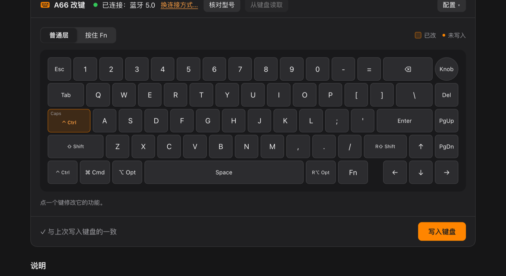

# A66 Keymap

新盟 A66 三模机械键盘的网页改键工具。在电脑上的 Chrome 或 Edge 里打开就能改键，不用装驱动，Windows、macOS、Linux 都能用。
A web-based key remapper for the A66 tri-mode mechanical keyboard. Open it in desktop Chrome or Edge — no driver needed.

**打开使用 / Open：https://www.neilpoly.top/a66/**

[中文](#中文) · [English](#english)

---

## 中文

### 声明

- 本项目是个人业余作品，不是官方工具，与键盘厂商无关。文中提到的产品名称归各自所有者。
- 仅限个人学习、研究等非商业用途，禁止任何商业使用，包括出售、收费服务、集成到商业产品中。具体条款见 [LICENSE](LICENSE)（PolyForm Noncommercial 1.0.0）。
- 本项目不包含原厂驱动或固件的任何代码和文件。
- 按现状提供，不作任何保证。使用造成的键位丢失、键盘异常等后果，由使用者自行承担。

### 能做什么

- 改普通层和按住 Fn 时的任意键：字母、数字、符号、方向、F 键、修饰键、多媒体键、组合键（如 ⌘←），以及键盘自身功能（切换蓝牙/2.4G、灯光、电量查询等）。
- 有线、蓝牙、2.4G 接收器都能写入。蓝牙列表里的 "A66 5.0" 和 "A66 3.0" 是同一把键盘，推荐连 A66 5.0。
- 有线和 2.4G 下能读出键盘里现在的键位，写完自动读回核对。**蓝牙下读不了键位**（键盘固件的限制），只能写入。
- 导入原厂 Windows 驱动的配置（`profile.dct`），导入/导出本工具的配置（JSON）。
- 不支持宏和灯效设置。

### 怎么用

1. 用电脑上的 Chrome 或 Edge 打开上面的网址。Safari、Firefox 和手机浏览器不支持。
2. 连上键盘（有线、蓝牙或 2.4G），点“连接键盘…”，在列表里选它。每种连接方式只需选一次。
3. 点一个键选新功能，切到“按住 Fn”可以改 Fn 层，然后点“写入键盘”。

macOS 上要注意：

- 要给浏览器开“输入监控”权限：系统设置 → 隐私与安全性 → 输入监控，打开后完全退出浏览器再打开。
- 装了 Karabiner-Elements 的话，蓝牙下写入前要在 Karabiner 的 Devices 里临时关掉这把键盘的 Modify events，写完再打开。有线和 2.4G 不受影响。

### 改键为什么会莫名丢失

出厂的 Fn + Caps Lock 是“复位键盘”：按住约 5 秒，所有改键被清回出厂，容易误触。页面会提示，可以一键把它挪到 Fn + Delete。

### 安全

- 只读写键位、读型号，不碰固件。
- 同一个 USB VID/PID 被多个品牌的键盘共用，所以每次读写前都会核对型号（`03 00 00 00 00 D9`），不是 A66 就不操作。
- 所有操作都在本机浏览器里完成，不上传任何数据。

### 开发

- `web/`：网页版源码，纯静态、零依赖，通过浏览器的 WebHID 和键盘通信。
  - 测试：`cd web && npm test`
  - 打包：`scripts/build-web.sh 0.1.0` 生成 `dist/web/`，放到任意 HTTPS 静态网站即可（WebHID 只能在 HTTPS 或 localhost 下用）。本机试用：`python3 -m http.server -d dist/web 8766`，打开 http://127.0.0.1:8766 。
- `docs/protocol.md`：键盘通信协议的整理（中文）。
- `Sources/`：macOS 命令行工具 `a66`（Swift），主要给开发排障用，不保证和网页同步更新。`swift build` 编译；`swift test` 跑单元测试（需要完整的 Xcode）；`a66 --help` 看用法。`node web/test/crosscheck.js` 可以把网页和命令行生成的报文逐字节对照。

### 许可

[PolyForm Noncommercial 1.0.0](LICENSE)：源码公开，允许个人学习、研究等非商业使用，禁止商业使用。

---

## English

### Disclaimer

- An unofficial hobby project, not affiliated with or endorsed by the keyboard maker. Product names belong to their respective owners.
- For personal study, research and other non-commercial use only. Commercial use — including selling it, paid services, or bundling it into commercial products — is not permitted. See [LICENSE](LICENSE) (PolyForm Noncommercial 1.0.0).
- Contains no code or files from the vendor's driver or firmware.
- Provided as is, without warranty of any kind. You use it at your own risk, including lost keymaps or keyboard malfunction.

### What it does

- Remap any key on the base layer and the Fn layer: letters, digits, symbols, arrows, F-keys, modifiers, media keys, combos (e.g. ⌘←) and the keyboard's own functions.
- Writes over USB, Bluetooth and the 2.4 GHz receiver. "A66 5.0" and "A66 3.0" in the Bluetooth list are the same keyboard; use A66 5.0.
- Over USB and 2.4 GHz it can read the keymap stored in the keyboard and verifies every write. **Over Bluetooth the keymap cannot be read** (a firmware limitation); writing works.
- Imports the vendor Windows driver profile (`profile.dct`); imports/exports its own JSON keymaps.
- No macro or lighting settings.

### Usage

1. Open the link above in desktop Chrome or Edge. Safari, Firefox and mobile browsers are not supported.
2. Connect the keyboard, click “Connect…” and pick it. Each connection type only needs this once.
3. Click a key to change it (switch to “Fn layer” for the Fn layer), then “Write to keyboard”.

On macOS, give the browser Input Monitoring permission and restart it. With Karabiner-Elements, turn off Modify events for the keyboard while writing over Bluetooth.

Factory Fn + Caps Lock is “reset keyboard”: holding it about 5 seconds wipes all remapping. The page offers to move it to Fn + Delete.

### Development

`web/` is the page (static, no dependencies; `cd web && npm test`; `scripts/build-web.sh 0.1.0` builds `dist/web/`). `docs/protocol.md` documents the protocol (in Chinese). `Sources/` holds a macOS command-line tool used for development and troubleshooting.

### License

[PolyForm Noncommercial 1.0.0](LICENSE): source available; personal, research and other non-commercial use is allowed, commercial use is not.
